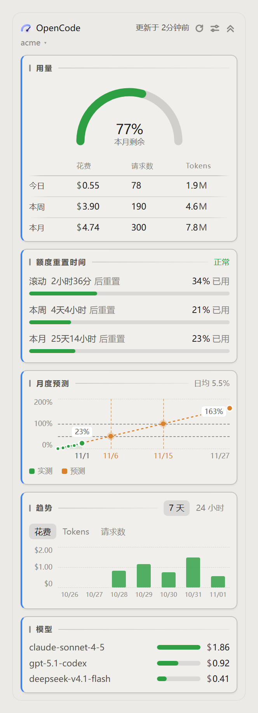
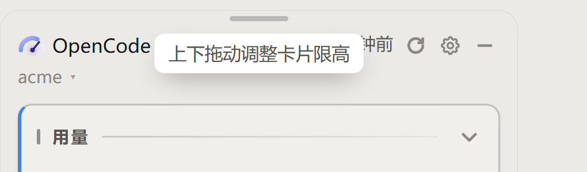
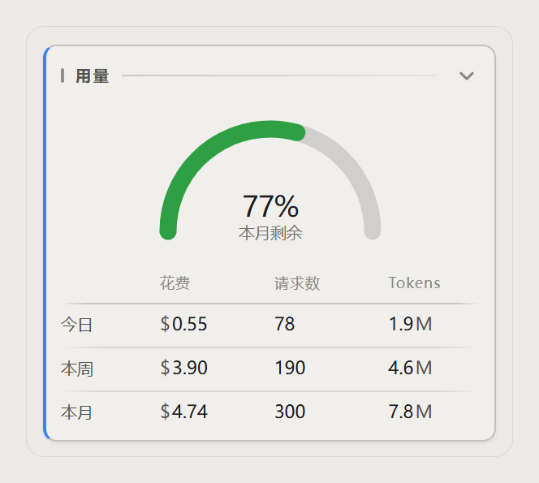
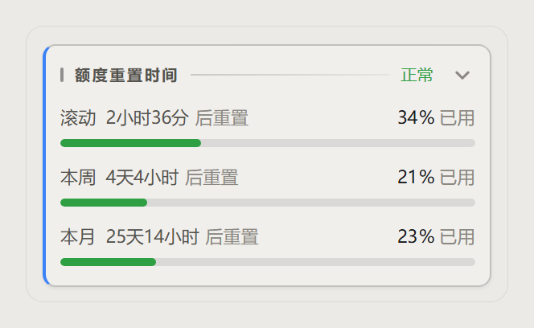
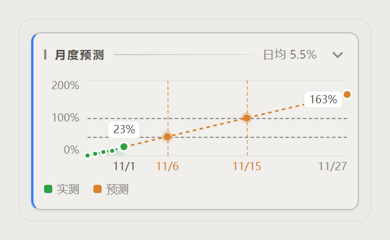
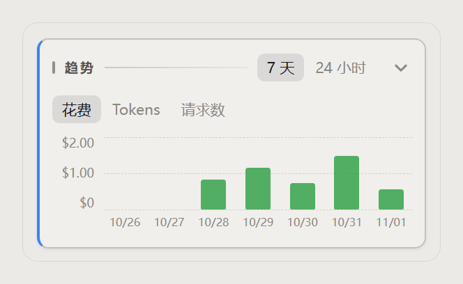
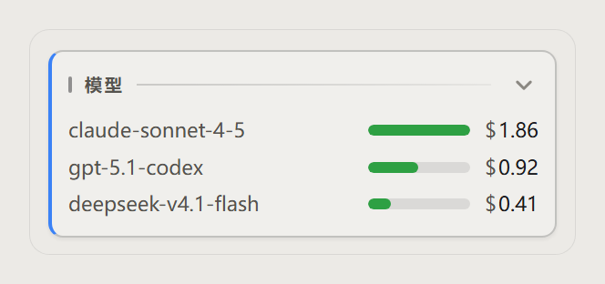
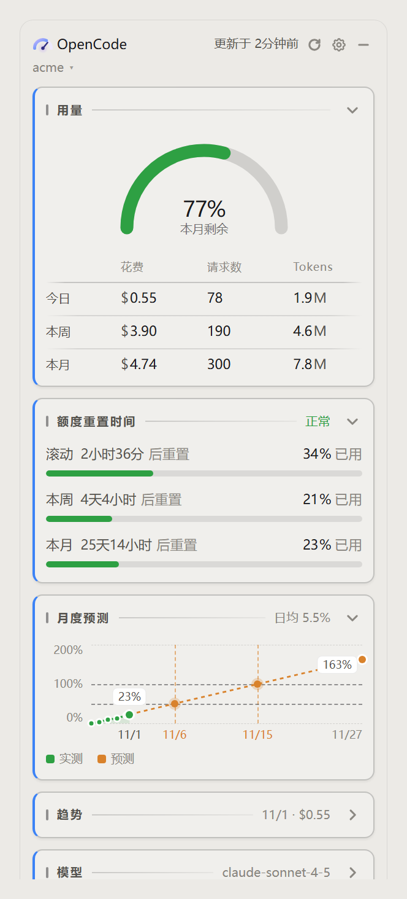
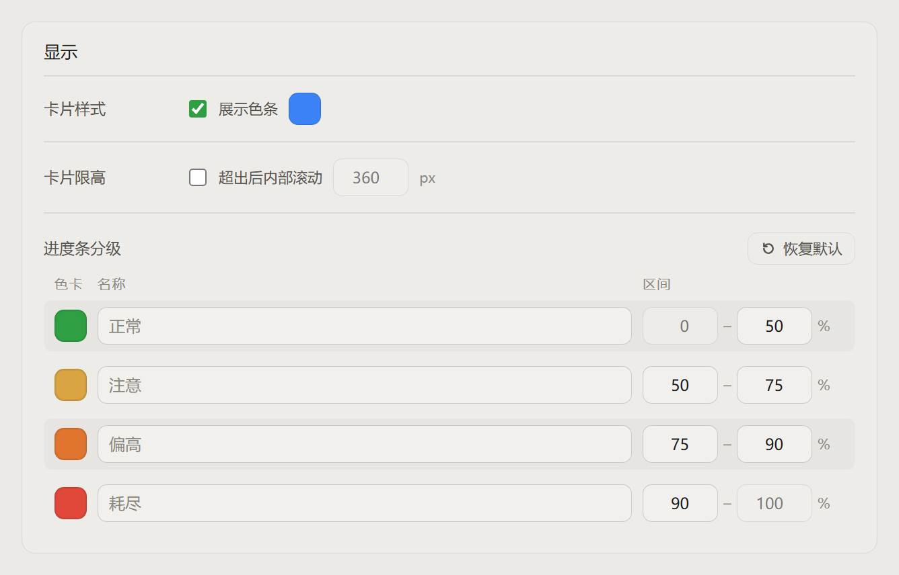
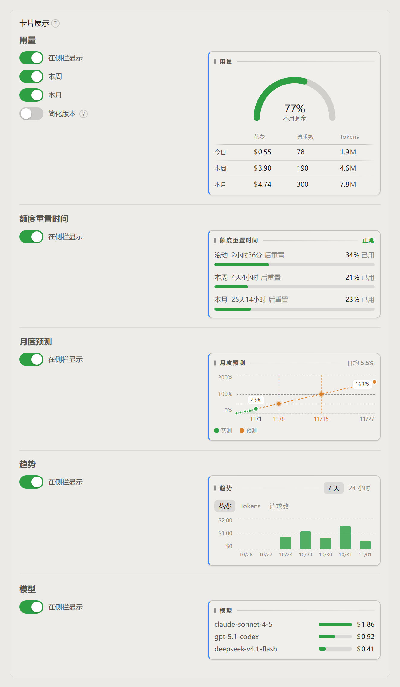

<div align="center">
  
</div>

<h1 align="center">OpenCode Usage Dashboard</h1>

<p align="center">
  <b>Quota, spend and usage for OpenCode — right in the DeepSeek Harness sidebar.</b>
</p>

<p align="center">
  
  
  
  
</p>

<p align="center">
  <a href="#install">Install</a> ·
  <a href="#ui">UI</a> ·
  <a href="#account-shapes">Account shapes</a> ·
  <a href="https://github.com/zhxmt-xm/dsh-opencode-usage-dashboard/blob/main/docs/README.md">Development</a>
  <br>
  <sub>简体中文: <a href="https://github.com/zhxmt-xm/dsh-opencode-usage-dashboard/blob/main/README.md">README.md</a></sub>
</p>

> [!NOTE]
> This is a third-party plugin for DeepSeek Harness. All data comes from OpenCode's official endpoints.

<div align="center">
  
  <br>
  <sub>Sidebar card (light theme, sample data): usage · quota · forecast · trend · models</sub>
</div>

## Why use it

OpenCode spreads quota, spend and usage across several endpoints: Go subscription windows (rolling / weekly / monthly) and Console spend with token counts. This plugin puts them on one sidebar card, so you don't need the web console or your own spreadsheet.

- **Works for Go and pay-as-you-go accounts**: quota windows when you have a Go subscription, spend/trend/models when you only have Console usage.
- **Know today's cost**: spend, requests and tokens for today, plus week and month totals.
- **See the trend**: 7 days / 24 hours, switchable between spend, tokens and requests.
- **Know before you run out**: with a monthly quota, the current billing-period burn rate is projected and the 50% / 100% dates are labelled.
- **Know which models cost money**: model bars sorted by spend.
- **Multiple accounts, no collisions**: keys of the same org are merged into one card, different orgs stay separate; switch accounts and filter spend by service account.
- **Configurable**: block order and visibility, rail colour, four-tier thresholds, trend metric, refresh interval.
- **Unobtrusive**: follows the DSH theme, Chinese/English UI, no external CDN, preferences stay on your machine.

## UI

Below: the five sidebar blocks and the three settings panels. Screenshots use fixed sample data (`acme` / `org_acme` and similar names are fictional); real numbers follow your account.

### Sidebar card

The card sits above the sidebar settings button. When the sidebar itself is collapsed it reduces to a small percentage/amount tile; expanded, it shows the blocks in your preferred order — only 「Usage」 and 「Quota reset」 are on by default, the rest can be enabled in settings. Every block has an arrow on the right of its title: click it to fold that block into a single row (title plus its key figure — usage shows today's spend, quota shows month-to-date usage, trend shows the latest bucket, models shows the top model), click again to expand. The card header has a collapse button as well; collapsed it becomes one line: "OpenCode + monthly remaining" (or total spend when there is no monthly quota). A drag strip above the card (a thin line appears on hover) resizes the card height; dragging until everything fits turns the height cap off automatically. The card header is also the account switcher: click the account name to change org / service account; refresh, settings and collapse buttons sit on the right.

<p align="center">
  
</p>

#### Usage

<p align="center">
  
</p>

- Spend, requests and tokens for today;
- the Tokens column shows a compact value; hover or keyboard-focus it for the exact number;
- with a monthly quota, the gauge on top shows the monthly remaining percentage;
- today / week / month are summarised side by side.

#### Quota

<p align="center">
  
</p>

- three windows: rolling 5 hours, this week, this month;
- bar colour follows the four-tier thresholds, the used percentage is on the right;
- each row carries a reset countdown; the whole block is hidden without a Go subscription.

#### Forecast

<p align="center">
  
</p>

- linear projection based on the current billing-period burn rate;
- green is measured, orange is projected, with 50% / 100% dates labelled;
- hidden without a monthly quota or with fewer than two data points.

#### Trend

<p align="center">
  
</p>

- 7 days / 24 hours;
- spend / tokens / requests;
- keeps the block with an empty-state message when there is no data.

#### Models

<p align="center">
  
</p>

- sorted by spend, bar length normalised to the highest value;
- at most four rows;
- hidden when there are no per-model billing records.

#### Folding a block

<p align="center">
  
</p>

- the arrow right of each block title folds it into one row and unfolds it again;
- while folded the title shows that block's key figure:
  - usage → `Today · $0.55`
  - quota reset → `This month · 23% used`
  - forecast → `11/27 · 163%` (reset date + projection at the current rate)
  - trend → `11/01 · $0.55` (`18:00 · $0.12` for 24 hours)
  - models → the top model name only
- on narrow cards the text is ellipsised with `…`; titles and arrows stay put;
- the last block's tooltip opens upwards so it is not clipped by the card edge.

### Settings

Settings → OpenCode plan. API keys stay in DSH's provider settings; this page is read-only.

#### Account

<p align="center">
  
</p>

- accounts are grouped by org; keys of one org share a card;
- the current account is marked 「Current」, the others offer 「Switch」; service accounts can be filtered separately;
- 「Refresh data」 re-reads immediately; the interval can be 30s / 1min / 5min / 15min;
- keys are read-only — change them in DSH settings → Providers (`llm-pi-ai`).

#### Appearance

<p align="center">
  
</p>

- card style: toggle the left rail, pick its colour next to it;
- card height cap: off by default; when enabled the block area is limited to the chosen pixel height and scrolls inside the card (header and account menu are never clipped). The ceiling is always "natural content height − 1px" and follows content changes live; the input only guards the range. You can also drag the handle on top of the card; dragging to the top (nothing left to scroll) turns the cap off once;
- bar tiers: four tiers, each with its own name, range and colour; ranges are contiguous;
- 「Reset to defaults」 restores 0–50 green, 50–75 yellow, 75–90 orange, 90–100 red.

#### Card blocks

<p align="center">
  
</p>

- one row per block: switches on the left, the real sidebar rendering on the right;
- 「Show in sidebar」 controls the whole block; 「Fold」 keeps only its title row (the key figure is shown, see "Folding a block" above); the usage block additionally offers 「Week」 and 「Month」 for the table rows and 「Compact」 — today only, the gauge shrinks to the left and spend / requests / tokens each take one row, dropping the block from ~230px to ~75px; while compact is on, week/month switches are greyed out (their choice is kept);
- hovering a row title reveals drag dots on the right; drag the title up or down to reorder;
- the trend's 7-day / 24-hour and spend / tokens / requests switches are clicked in the preview; the 24-hour axis thins its labels automatically to the card width;
- the `?` after 「Compact」 explains that option; the `?` next to the panel title is a general hint.

> There is no separate "trend" settings panel: range and metric are switched right in this preview.

## Account shapes

The five blocks are decided by **API data**, not by a config switch and not by the provider name:

| Shape | What you see |
| --- | --- |
| Go subscription only | all five blocks |
| Console pay-as-you-go only | quota and forecast hidden; usage, trend and models remain |
| Go + Console | merged into one card, same as "Go only" |

The plugin treats `GET /inference/go/v1/usage` returning 200 vs 404 as the Go subscription check; the provider id only decides which key is preferred. Full rules in [Development → Account shapes](https://github.com/zhxmt-xm/dsh-opencode-usage-dashboard/blob/main/docs/README.md#账户形态).

## Install

### Requirements

- DeepSeek Harness Desktop 0.2.x (developed on `0.2.1-rc.5`; the Web profile works the same way);
- an OpenCode Go subscription, or an OpenCode account with Console usage only;
- network access to `opencode.ai`.

### From DSH Market (recommended)

The plugin is listed in the DSH plugin market:

1. Open DSH → Settings → **Plugins** (or the plugin market);
2. search for `dsh-opencode-usage-dashboard` or 「OpenCode usage」;
3. click **Install** — the card shows up in the sidebar.

The market version follows npm; features from `1.2.0` on (foldable blocks, unified tooltips, …) need market version ≥ 1.2.0.

> **After upgrading click 「Restart」, not 「Refresh page」**: this plugin registers `/api/opencode-quota/*` routes on the host side, which makes it a host module — DSH cannot hot-swap it. Refreshing the page ends with `import failed`; restarting is enough. The same applies to a fresh install.

### From GitHub

```sh
dsh plugin --profile desktop add github:zhxmt-xm/dsh-opencode-usage-dashboard
```

Web profile:

```sh
dsh plugin --profile web add github:zhxmt-xm/dsh-opencode-usage-dashboard
```

> The `github:` source needs the git protocol to `github.com:443`. If that is blocked, use npm, or a tag-pinned codeload tarball:
> `dsh plugin --profile web add https://codeload.github.com/zhxmt-xm/dsh-opencode-usage-dashboard/tar.gz/refs/tags/v1.2.1`

### From npm

```sh
dsh plugin --profile desktop add dsh-opencode-usage-dashboard
```

### Migrating from the old package name

Before 2026-10-30 the package was called `@local/dsh-opencode-quota` (0.1.0) — a **different package**. Upgrading from it requires an uninstall first, otherwise both copies stay installed and the sidebar keeps showing the old card:

```sh
dsh plugin --profile web remove @local/dsh-opencode-quota
dsh plugin --profile web add dsh-opencode-usage-dashboard
```

Then click 「Restart」 (not 「Refresh page」) — see above.

### Local development install

Run from the repository root:

```powershell
npm start
```

This is a source switcher for local development; it asks which source to install:

- **1) local link**: point the desktop profile back at this repository, reload the plugin after edits (restart DSH if needed);
- **2) GitHub**: install the GitHub build, to verify what users actually get.

The script always runs "uninstall → clean old junctions/temp dirs in `node_modules` → install the chosen source". DSH does not remove the junction when uninstalling a `link:` install, and switching directly would fail with `EPERM`, so don't rely on DSH's uninstall button alone when moving from link to GitHub.

You don't need to quit DSH first: `dsh plugin` just forwards to pnpm inside the profile directory, which does not conflict with a running DSH. Profiles ship `@deepseek-ai/dsh-hmr` (empty `root`, watching only the profile manifest and patch files), so DSH recomposes plugins whenever the profile changes; a restart is only needed when it says "restart DSH for the change to take effect" (`package-moved`, `host-module`, and similar). If files are genuinely locked (`EBUSY` / `EPERM`) the script asks you to quit DSH and rerun. The `dsh` command must be on PATH. The script targets the `desktop` profile by default; to pick another profile or a proxy:

```powershell
$env:DSH_PROFILE = 'web'
$env:DSH_PROXY = 'http://127.0.0.1:7890'
npm start
```

The GitHub option needs access to github.com; when `DSH_PROXY` is unset it defaults to `http://127.0.0.1:7890`.

Without the script you can also install a local link manually:

```powershell
dsh plugin --profile desktop add "link:C:\path\to\dsh-opencode-usage-dashboard"
```

`link:` references the local directory directly; after editing code reload the plugin (restart DSH if needed) — no reinstall required.

### Configure keys

The plugin reads the `opencode` / `opencode-go` provider credentials that already exist in DSH:

1. open DSH settings → Providers (`llm-pi-ai`);
2. configure the API key for `opencode-go` and/or `opencode`;
3. go back to 「Settings → OpenCode plan」 and click 「Refresh data」.

Keys can also come from environment variables: `OPENCODE_GO_API_KEY` / `OPENCODE_API_KEY`. The settings page is read-only and never sends keys to the browser.

### Update / uninstall

```sh
# GitHub install: run add again; if no new commit is picked up, remove then add
dsh plugin --profile desktop add github:zhxmt-xm/dsh-opencode-usage-dashboard

# npm install (the Market also offers an update button)
dsh plugin --profile desktop add dsh-opencode-usage-dashboard

# uninstall
dsh plugin --profile desktop remove dsh-opencode-usage-dashboard
```

## Data and privacy

- API keys are used only inside the DSH host process; they are never sent to the browser and never logged;
- quota data is not persisted; UI preferences live in the browser's `localStorage`;
- every host route accepts loopback requests only and validates `Origin` / `sec-fetch-site`;
- upstream requests time out after 12s, refuse redirects, and cap the response body at 256 KB.

Architecture, endpoints, known limitations, debugging and the release checklist live in [docs/README.md](https://github.com/zhxmt-xm/dsh-opencode-usage-dashboard/blob/main/docs/README.md).

## License

- plugin code: MIT, see [LICENSE](https://github.com/zhxmt-xm/dsh-opencode-usage-dashboard/blob/main/LICENSE);
- bundled Noto Sans SC font: SIL OFL 1.1, see [THIRD_PARTY_NOTICES.md](https://github.com/zhxmt-xm/dsh-opencode-usage-dashboard/blob/main/THIRD_PARTY_NOTICES.md).

---

<div align="center">
  <sub>Made for DeepSeek Harness · data from OpenCode</sub>
</div>
