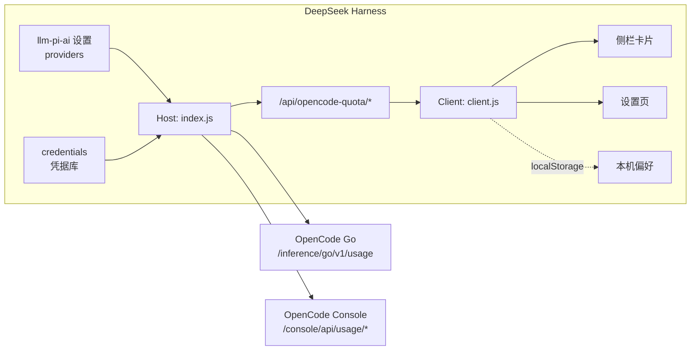

# 开发与原理

`dsh-opencode-usage-dashboard` 是一个 DeepSeek Harness（DSH）插件：Host 半边读取 OpenCode 的 Go 订阅额度与 Console 用量，浏览器半边把它们画进侧栏卡片和设置页。

产品介绍、截图和安装方式见根目录 [README](../README.md)。本文面向维护者，说明插件怎么工作、数据从哪来、如何本地调试，以及参考图怎么生成。

## 目录

- [架构](#架构)
- [Host 半边](#host-半边)
- [浏览器半边](#浏览器半边)
- [数据来源](#数据来源)
- [账户形态](#账户形态)
- [卡片分块与空态](#卡片分块与空态)
- [安全](#安全)
- [已知限制](#已知限制)
- [本地开发](#本地开发)
- [参考图](#参考图)
- [许可](#许可)

## 架构

### 两个半边

| 半边 | 入口 | 注入 | 职责 |
| --- | --- | --- | --- |
| Host | `index.js` | `webServer`、`credentials`、`settings` | 读 DSH 设置与凭据、请求 OpenCode、合并账户、注册本机 HTTP 路由、写客户端日志 |
| Client | `client.js` | `slots`、`locale` | 注册侧栏卡片与设置分区、轮询 Host 路由、渲染图表、保存本机偏好、中英词典 |

Host 不把 Key 下发给浏览器；浏览器只拿已经归一化的额度/用量 JSON。所有上游请求由 Host 发出，因此没有跨域问题，也能把超时、响应大小和错误文案收在一处。

`client.js` 以 `window.__ModuleLoader__.load({ id, factory })` 注册，React 由宿主提供，不打包 React。

### 数据流



`cordis.patch.yml` 把插件作为一条 Host 行插入 profile 根部；行 id `opencode-quota` 同时是设置项和插件管理里的标识。

`package.json` 的 `dsh` 字段声明 bundle patch 与 client 半边（`platform: web`、`immediately: true`、注入 `@deepseek-ai/dsh-client-locale`）；`exports` 暴露 Host、Client、locale、icon 和 package 元数据。没有构建步骤，`files` 直接发布源码。

### 文件结构

| 路径 | 作用 |
| --- | --- |
| `index.js` | Host 半边：账户发现、订阅探测、上游请求、路由、安全校验、客户端日志 |
| `client.js` | 浏览器半边：侧栏卡片、设置页、图表、偏好、词典、CSS、设置导航 logo 补丁 |
| `cordis.patch.yml` | bundle patch：把插件插入 profile |
| `locale/zh.json`、`locale/en.json` | 插件管理里的标题与描述（DSH 插件元数据） |
| `icon.svg` | 插件 logo |
| `LICENSE` | 插件代码的 MIT 许可 |
| `.smoke.mjs` | 无框架冒烟测试：模拟 DSH 上下文与上游，验证路由、合并、降级、安全 |
| `docs/render-scenarios.cjs` | 用迷你 React 替身渲染 `client.js`，生成参考图与单块截图底稿 |
| `docs/scenarios.html` | 生成的账户形态 × 分块空态静态底稿 |
| `docs/scenarios.png` | 账户形态 × 分块空态参考图（维护者用，根 README 不再整张嵌入） |
| `docs/settings.html` | 生成的设置页静态底稿，含账户 / 显示 / 卡片展示三个面板 |
| `docs/shots/*.png` | 根 README 用的单块 / 单面板截图 |
| `docs/capture-shots.ps1` | 调用 Edge 批量截取 `docs/shots/*.png` 的 Windows 脚本 |
| `docs/screenshot-card.png` | 根 README 用的侧栏卡片整体截图 |

插件管理里的标题/描述在 `locale/*.json`；设置分区 label 与卡片/设置页正文词典在 `client.js` 的 `zh` / `en` 对象里，改文案时两处都要看。

## Host 半边

### 启动与容错

`apply(ctx, config)` 包一层 `try/catch`，激活失败只写 `console.error`，不拖垮 DSH。`config.baseURL` 可覆盖 Go 接口地址，默认 `https://opencode.ai/inference/go/v1`。

注入三个服务：

- `webServer`：注册 `/api/opencode-quota/*`；
- `credentials`：按引用解析、写入 DSH 凭据；
- `settings`：读取 `llm-pi-ai` 的 provider 列表。

### 账户发现

1. 从 `settings.describe({ redactSecrets: true })` 找到 `ns: 'llm-pi-ai'` 的 `providers`；
2. provider id 以 `opencode-` 开头（或就是 `opencode`），或 `baseURL` 指向 `opencode.ai`，才算候选；
3. 每个 provider 的 Key 引用优先取 `apiKeyEnv`，缺失时按预设回落：Go → `OPENCODE_GO_API_KEY`，Console → `OPENCODE_API_KEY`；
4. 用 Key 解析身份：
   - 优先调 `/console/api/service-accounts`，用 Key 前缀匹配 `keys[].tokenHint`，得到服务账号；
   - 匹配不到服务账号时，调 `/console/api/usage/users` 拿用户；
   - 调 `/console/api/config`，从 provider header 里取 `x-opencode-org-id`；
   - 调 `/console/api/members`，用 owner 的邮箱作为组织名；
   - 账户 id 优先用组织 id，其次服务账号 id，最后用户 id；
   - 都读不到时退回 `ref:<apiKeyEnv 或回退变量>`，保证不误合并。
5. 同一个组织下的多个 provider 合并成一张卡；能识别出真实账户时，没配 Key 的兜底 provider 不会单独画空账户。

`kind` 只是 DSH 的连接预设（决定优先用哪把 Key），不代表计费方式；订阅与否由接口探测。

### 订阅探测

用 `/inference/go/v1/usage` 的 200/404 判断：

- 200：有 Go 订阅；
- 404（`NOT_SUBSCRIBED`）：没有 Go 订阅；
- 网络错误 / 401 / 403 / 5xx：这次判断不了，`hasGo = null`，不武断降级。

探测是组织级的，按账户缓存 60 秒。候选 Key 按 `go` 预设优先排序，任意一把能给出明确结果就停。`readView` 在已知没有订阅时会跳过额度请求；手动刷新（`fresh=1`）会重新探测。

### 读一次视图

`readView(account, fresh, sa)`：

1. 取该账户所有可解析的 Key，Go 预设优先；
2. `summary`：`/usage/summary?since=<本地今日 0 点>`；
3. `hourly`：先请求 `cost-by-day?range=7d&bucket=hour`，一次拿 7 天小时桶；失败或为空时退回 `range=7d` 日桶 + `range=24h&bucket=hour`；
4. `compare`：本周与上周（周一为界，本地时区）的 summary；
5. `models`：`/usage/models?pageSize=6`，取前 6；
6. `quota`：`/inference/go/v1/usage`，归一化三个窗口；
7. `period`：用 monthly 的 `resetsAt` 反推当前计费周期，取 `cost-by-day?from=…&to=…` 的每日花费；
8. 结果缓存 10 秒；`fresh=1` 跳过缓存。

所有上游请求：12 秒超时、拒绝重定向、响应体上限 256 KB、只接受 JSON。401/403 会提示检查 Key；404 统一映射为 `NOT_SUBSCRIBED`。

### 路由

| 方法 | 路径 | 作用 |
| --- | --- | --- |
| `GET` | `/api/opencode-quota/state` | 账户列表与凭据状态；含 `hasGo`、`kind`、`members`、每个 provider 的 `configured/source` |
| `GET` | `/api/opencode-quota/usage?account=…&sa=…&fresh=1` | 账户状态 + 额度/用量视图；`sa` 只过滤花费与模型，额度仍是组织级 |
| `POST` | `/api/opencode-quota/key` | `{ ref, key }` 写入或清空凭据；当前设置页只读，Key 在 DSH provider 设置里管理，这个路由保留给旧版/脚本 |
| `POST` | `/api/opencode-quota/log` | `{ text }` 写客户端日志，最多 4000 字符 |

`/usage` 在账户没有 Key 时返回 200 + `quota: null`、`summary: null`，让前端显示空态而不是报错。

### 缓存

| 缓存 | 粒度 | 时长 |
| --- | --- | --- |
| 视图 | `account id + sa` | 10 秒 |
| Go 订阅探测 | 账户（org id） | 60 秒 |
| 身份 | Key 引用 | 进程生命周期 |
| 服务账号列表 | 明文 Key | 进程生命周期 |
| 组织 owner | 明文 Key | 进程生命周期 |

写入 Key 后会清空身份、服务账号、视图和探测缓存。

## 浏览器半边

### 注入点

- `sidebar.footer.action`：侧栏设置按钮上方的额度卡片，`order: -1000`；
- `settings.section`：设置里的「OpenCode 套餐」页，`order: 85`；
- `locale`：注册 `zh` / `en` 词典，`settings.section` 的 label 也走词典。

侧栏卡片收起时退化为百分比/金额小方块；展开时按偏好顺序渲染五个分块。设置页用 `headless + manage` 渲染同一套分块，标题前多勾选框，可拖拽排序。

### 轮询与可见性

- 首次挂载立即 `refresh({ fresh: true })`；
- 按 `intervalSec`（默认 60 秒，范围 10–3600）定时刷新；
- 页面不可见时跳过定时刷新；
- `visibilitychange` 回到可见时立即刷新；
- 手动刷新按钮走 `fresh=1`。

### 偏好与迁移

偏好存在 `localStorage` 的 `opencode-quota:prefs`，只影响本机显示：

| 字段 | 默认 | 说明 |
| --- | --- | --- |
| `tiers` | 四档：0–50 绿、50–75 黄、75–90 橙、90–100 红 | 名称、区间、颜色 |
| `tiersVersion` | `4` | 旧四段区间升级标记 |
| `uiVersion` | `2` | 旧配色/样式升级标记 |
| `intervalSec` | `60` | 刷新间隔 |
| `account` | `''` | 当前账户 id |
| `sa` | `''` | 当前服务账号过滤 |
| `trendRange` | `'7d'` | `7d` / `24h` |
| `trendMetric` | `'cost'` | `cost` / `tokens` / `requests` |
| `style` | `'rail'` | `rail` / `panel` |
| `railColor` | `#3b82f6` | 色条颜色 |
| `order` | 五块固定顺序 | 侧栏分块顺序 |
| `hidden` | `['forecast','trend','models']` | 侧栏隐藏的分块；默认只显示用量与额度 |
| `blocksVersion` | `1` | 默认分块集合的迁移标记 |
| `collapsed` | `false` | 侧栏卡片是否手动收起 |
| `capHeight` | `false` | 是否给分块区限高 |
| `capPx` | `360` | 限高像素，上限是量到的内容高度减 1（`contentPx - 1`），范围保护 120–1200 |
| `contentPx` | `0` | 最近一次量到的分块内容自然高度，用来给 `capPx` 定上限 |
| `todayWeek` | `true` | 用量块是否显示「本周」行 |
| `todayMonth` | `true` | 用量块是否显示「本月」行 |
| `todayCompact` | `false` | 用量块是否用简化版式（只留今日） |
| `collapsedBlocks` | `[]` | 侧栏里被收起（只留标题行）的分块 id |

读偏好时会校验类型、补齐缺失分块、忽略未知 id；坏数据回落到默认值。旧版 `accent` 会迁移到第一档颜色。

`hidden` 的默认值在 1.1.0 从「全显示」改成「用量 + 额度」，迁移只在 `blocksVersion` 缺失且存下来的 `hidden` 为空数组（＝从没动过分块）时生效；动过分块的人保留自己的选择。用户改动任意偏好后会写回 `blocksVersion`，此后不再迁移。

### 分块收起

`collapsedBlocks` 存的是「只留标题行」的分块 id，和 `hidden`（整块不渲染）互不影响：隐藏优先，但收起状态会保留。

收起后标题右侧改成该块的关键数据（都在 `LimitsCard` 里算）：

| 分块 | 收起时显示 | 来源 |
| --- | --- | --- |
| 用量 | `当日 · $0.55` | `summary.costUsd` |
| 额度重置时间 | `本月 · 23% 已用` | `quota.monthly.percent` |
| 月度预测 | `11/27 · 163%` | `QuotaForecast` 里按当前速度外推到重置日 |
| 趋势 | `11/01 · $0.55` / `18:00 · $0.12` | 最后一个桶，跟着 `trendMetric` 变 |
| 模型 | 第一名模型名 | `models[0].model` |

`.oqc-blockMeta` 是可压缩的（`flex:0 1 auto; min-width:0; max-width:72%`），文本包在 `.oqc-blockMetaText` 里做 `text-overflow:ellipsis`，窄卡片下只省略数字部分，标题和箭头不动。

### 悬停提示

所有提示统一走 `.oqc-htip[data-hint]`（`::before` 画气泡，0.2s 延迟淡入），不再用原生 `title`；问号按钮也走这一套。

| 属性 | 作用 |
| --- | --- |
| `data-side="start"` / `"end"` | 气泡左对齐 / 右对齐（贴边的按钮用 `end`） |
| `data-wrap="true"` | 长文案换行（固定 240px 宽） |
| `data-up="true"` | 气泡朝上（表格底部、最后一个分块） |

最后一个分块的提示由 `.oqc-slot:last-child .oqc-htip::before` 自动翻到上方；悬停收起箭头时 `.oqc-blockHead:has(.oqc-blockToggle:hover)::before` 会让标题的拖拽提示让位，避免两个气泡叠在一起。

### 设置导航图标

DSH 的 `settings.section` 只投影 `id / order / label`，没有 icon 字段，第三方分区在导航里一律回落到齿轮。插件在设置弹窗里按当前语言的分区名认领本行，隐藏默认齿轮并换成本地 logo；`MutationObserver` 监听 DOM，语言切换后重新同步。上游改导航 DOM 时需要跟着调整。

## 数据来源

| 数据 | 接口 | 作用域 |
| --- | --- | --- |
| 三个额度窗口 | `GET https://opencode.ai/inference/go/v1/usage` | **组织级**，不支持按服务账号过滤 |
| 是否 Go 订阅 | 同一个 `GET /inference/go/v1/usage`：200 = 有，404 = 无 | 组织级；任一服务账号 Key 都能探测 |
| 今日花费与 token | `GET https://opencode.ai/console/api/usage/summary?since=…` | 默认组织，可加 `serviceAccountId=` |
| 按天/按小时花费 | `GET https://opencode.ai/console/api/usage/cost-by-day?range=…` | 同上 |
| 按模型花费 | `GET https://opencode.ai/console/api/usage/models` | 同上 |
| 账户身份 | `GET /console/api/service-accounts` 的 `keys[].tokenHint`（Key 前缀）匹配出服务账号；读不到时退回 `/usage/users`、再退回 `/config` 的 org id | 组织级列表 |

`/usage/users` 不区分 Key（同组织的两个 Key 都返回同一个用户），所以身份优先用 `service-accounts` 的 `tokenHint` 前缀匹配。花费与模型按服务账号过滤，额度是组织共享的一份。

Key 来自 DSH 凭据库：优先用 `llm-pi-ai` 里该 provider 的 `apiKeyEnv`，缺省回落到 `OPENCODE_GO_API_KEY` / `OPENCODE_API_KEY`。

金额换算：上游 `totalCostMicroCents` 除以 `1e8` 得到美元。

## 账户形态

卡片的五个分块由**接口数据**决定，不是配置开关，也不看 provider 名：

| 形态 | 触发条件 | 渲染结果 |
| --- | --- | --- |
| 只有 Go 订阅 | 任一 Key 调 `GET /inference/go/v1/usage` 返回窗口 | 五块齐全 |
| 没有 Go 订阅（Console 用量） | 该接口 404（`NOT_SUBSCRIBED`） | 额度、预测整块隐藏；用量没有油表，只留表格 |
| Go + Console 用量 | 同一个组织既有 Go 订阅、又有 Console 花费 | 合并成一张卡，与「只有 Go」一致 |

DSH 里的 `opencode-go` / `opencode` 只是两个连接预设，不能拿来判断计费方式：同一个组织的任意服务账号 Key 都能读 Go 额度，额度本身也是组织级共享的。插件用 `/inference/go/v1/usage` 的 200/404 做订阅探测，provider id 只决定优先用哪把 Key。

## 卡片分块与空态

| 分块 | 数据 | 没有数据时 |
| --- | --- | --- |
| 用量 | summary（今日）、compare（本周）、period（本月） | 全无则整块隐藏；没有月度额度时不画油表，只留表格 |
| 额度 | Go 三个窗口 | 无 Go 订阅整块隐藏；窗口在但 `percent` 缺失显示 `—` |
| 预测 | monthly + period.daily | 无月度额度或有效点不足两个则整块隐藏 |
| 趋势 | `daily` / `hourly` | 保留分块，显示「这段时间没有用量数据」 |
| 模型 | `/usage/models` 前 6，卡片只画前 4 | 无记录整块隐藏 |

用量表的 Tokens 列默认显示紧凑值（K / M / B），悬停或键盘聚焦时显示精确到个位的数字；数字来自 input / output / cache-read token 之和，Host 已归一化为整数。

预测的算法：把当前计费周期的每日花费累加成曲线，按「周期总花费 → monthly.percent」等比折算成百分比；用本周期起点到现在的平均速度外推到重置日，得到预计百分比与 50% / 100% 穿越日期。它不是额度历史采样，只是「按当前花费速度」的线性外推。

空态与三种账户形态的完整参考见 [scenarios.png](scenarios.png)。

## 安全

- 所有 Host 路由只接受本机回环请求，并校验 `Origin` / `sec-fetch-site`；
- Key 只在 Host 进程内使用，不下发到浏览器、不写日志；
- 额度数据不落盘；界面偏好写在浏览器 `localStorage`，客户端错误日志写到 `$DSH_HOME/opencode-quota/client.log`；
- 上游请求 12 秒超时、拒绝重定向、响应体上限 256 KB；
- 请求体上限 8 KB，只接受 JSON。

## 已知限制

- **读不到套餐类型**（Go / Go Plus）：控制台的 `GET /console/api/orgs/current` 里其实有 `hasGoSubscription` / `goSubscription`，但服务账号 Key 调它返回 403，只接受控制台会话；`/api/internal/orgs/:orgId/go/status` 也不对外。插件因此只判断「有没有 Go 订阅」，分不清 Go / Go Plus。
- **预测只用当前计费周期**：没有额度历史接口，预测来自当前周期的每日花费；周期数据不足两个点时隐藏预测块。
- **没有按模型按天的数据**：`cost-by-day` 不接受模型维度，模型只有区间总量。
- **设置导航图标是 DOM 补丁**：`settings.section` 只投影 id / order / label，没有 icon 字段；插件在设置弹窗里按当前分区名认领本行，隐藏默认齿轮并换成本地 logo，语言切换会重新同步。上游改导航 DOM 时需要跟着调整。
- provider id 不是 `opencode` / `opencode-*`，且 `baseURL` 不指向 `opencode.ai` 时，不会被识别；指向其它中转站的自定义 provider 需要按这两个条件命名或配置地址。
- 额度接口是组织级，服务账号筛选只作用于 Console 花费与模型，不影响额度数字。

## 本地开发

### 环境

- Node.js 20+（使用全局 `fetch`、`AbortSignal.timeout`）；
- DeepSeek Harness Desktop 0.2.x（当前开发环境 `0.2.1-rc.5`）；
- 无运行时依赖，无构建步骤；`index.js` / `client.js` 直接发布。

### 开发建议

- 保持原生 ESM + React（由 DSH 提供），不要引入构建步骤或运行时依赖；
- Host 逻辑集中在 `index.js`，浏览器 UI 在 `client.js`，bundle patch 在 `cordis.patch.yml`；
- 改 UI 后先跑 `node .smoke.mjs`，再跑 `docs/capture-shots.ps1` 更新参考图和 README 截图；
- 设置页的 Key 保持只读，Key 统一在 DSH 的 provider 设置里管理。

### 安装到本地 profile

```powershell
dsh plugin --profile desktop add "link:C:\path\to\dsh-opencode-usage-dashboard"
```

也可以在 GUI 里：左侧栏 → **插件** → **添加插件**，粘贴本仓库绝对路径，安装后点 **立即启用**。

安装后按 DSH 的插件重载提示操作；改代码后重载插件（必要时重启 DSH），`link:` 不需要重新安装。

### 冒烟测试

```bash
node .smoke.mjs
```

脚本用假的 DSH 上下文和 `fetch` 覆盖：未配置 Key、同组织合并、只剩 Console Key 也能探测 Go、10 秒缓存、404 降级、小时桶回退、跨组织拆分、跨站/非回环拒绝等。当前 32 项检查全部通过。

### 调试

- 浏览器端激活/报错会 POST 到 `/api/opencode-quota/log`，写到 `$DSH_HOME/opencode-quota/client.log`；
- Host 端激活失败写 `console.error`，前缀 `[opencode-quota]`；
- 设置页「刷新数据」会带 `fresh=1`，可用来验证上游实时返回。

### 发布检查

1. `node .smoke.mjs` 全绿；
2. 用真实账户验证三种形态（有 Go / 无 Go / Go + Console）；
3. 重新生成参考图，确认没有意外 UI 变化；
4. 更新版本号与 README 截图；
5. 打 tag 后从 GitHub 安装验证一次：`dsh plugin --profile desktop add github:zhxmt-xm/dsh-opencode-usage-dashboard#<tag>`。

## 参考图

根 README 不再嵌整张场景图，而是按界面拆成单块 / 单面板截图，放在 `docs/shots/`：

| 文件 | 内容 |
| --- | --- |
| `shots/card-today.png` | 用量分块 |
| `shots/card-quota.png` | 额度分块 |
| `shots/card-forecast.png` | 预测分块 |
| `shots/card-trend.png` | 趋势分块 |
| `shots/card-models.png` | 模型分块 |
| `shots/settings-account.png` | 设置页账户面板 |
| `shots/settings-display.png` | 设置页显示面板 |
| `shots/settings-preview.png` | 设置页卡片展示面板 |

维护者用的完整参考图：

- `scenarios.png` — 三种账户形态 × 每个分块的空态（浅色主题，约 1345 × 3127）。**A 段**每种形态都保留全部五个分块，产品里会整块隐藏的分块画成虚线禁用块，位置不动；**B 段**每个分块的不同空态各占一格。
- `settings.html` — 设置页完整底稿，账户 / 显示 / 卡片展示三个面板一次看全。
- `screenshot-card.png` — 侧栏卡片整体截图，根 README 顶部使用。

图不是手绘的：`render-scenarios.cjs` 用一套极小的 React 替身直接在 Node 里跑 `client.js` 的组件，把元素树序列化成静态 HTML，再交给浏览器排版。单块截图只保留一个分块，单面板截图从设置页 DOM 里按 `.oqc-panel` 拆出，仍然是同一套组件和同一份样例数据。

### 重新生成

```bash
node docs/render-scenarios.cjs
```

写出 `docs/scenarios.html`、`docs/settings.html` 和 `docs/shots/*.html`。后者是截图中间产物，已被 `.gitignore` 忽略。

```powershell
powershell -ExecutionPolicy Bypass -File docs/capture-shots.ps1
```

脚本会再跑一次 `render-scenarios.cjs`，用 Edge 无头模式截取 `docs/shots/*.html`，并顺带重截 `docs/screenshot-card.png` 和 `docs/scenarios.png`；按背景色裁掉空白并补内边距。只支持 Windows（依赖 Edge 和 `System.Drawing`）。

只改 `scenarios.png` 时也可以手动截图：

```powershell
& "C:\Program Files (x86)\Microsoft\Edge\Application\msedge.exe" --headless=new --disable-gpu `
  --hide-scrollbars --force-device-scale-factor=1.4 --window-size=960,2700 `
  --screenshot=docs\scenarios.png "file:///<仓库路径>/docs/scenarios.html"
```

截图比页面高，底部会有一段背景色，按背景色 `#eceae6` 裁掉即可（内容下沿留 20px 左右）。

`docs/screenshot-card.png` 是侧栏卡片整体截图，由 `capture-shots.ps1` 从 `card-hero.html` 生成；改卡片布局后重跑脚本即可。

### 数据是写死的

脚本把「现在」固定成 `2026-10-29 15:40 (UTC+8)`，并把全局 `Date` 固定在同一时刻，因此重置倒计时、「x 分钟前」、趋势日期和预测斜率都可重复；花费、tokens、模型、趋势曲线本身是常量，所以同一版本重复渲染出来的图基本一致。

判断依据来自真实代码路径：`quota` / `windows` 为 `null` 就是没有 Go 额度，预测块缺 `monthly` 或周期点数不足就返回 `null`——这些分支与线上完全一致，只是数据换成了样例。账户名、组织 id、服务账号名也都是虚构的（`acme` / `org_acme` / `main` / `ci`），不对应真实账户。

## 许可

插件代码以 MIT 许可发布，见 [LICENSE](../LICENSE)。

内嵌 Noto Sans SC 子集/完整字体，SIL OFL 1.1，详见 [THIRD_PARTY_NOTICES.md](../THIRD_PARTY_NOTICES.md)。
